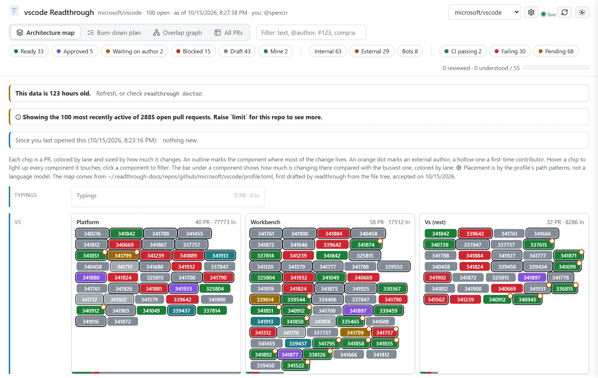
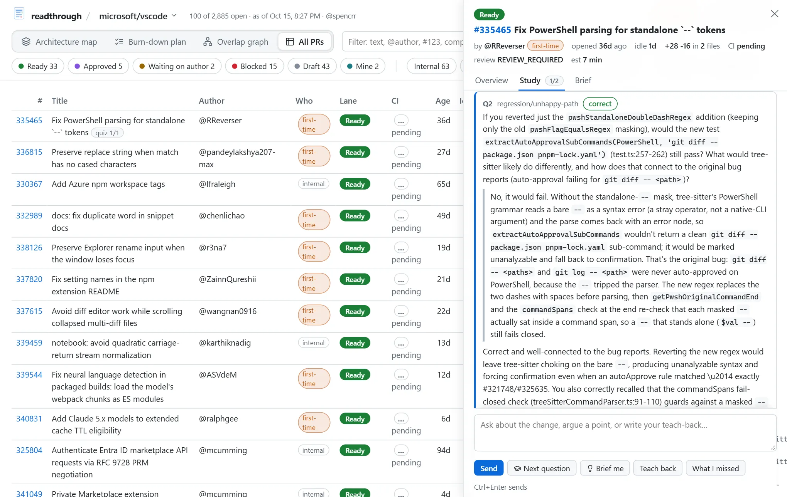

#  readthrough

Busy repos have fifty-plus open pull requests. I wanted two things from a queue like that: a picture of where the work is landing in the architecture, and a way to review PRs that leaves me actually understanding them, instead of skimming a diff and clicking approve.

readthrough does both, for repos on GitHub, GitLab, Forgejo (Codeberg), or Azure DevOps. It pulls every open PR and places it on the repo's architecture (its layers and components), marking which ones come from outside contributors and which have CI trouble. It packs the reviewable ones into hour-long sessions grouped by component, then gives each PR a study brief.

From there you can go two ways. A button on each PR starts a deep-review session in a terminal, in the GitHub Copilot CLI or Claude Code, where you predict what the PR does, answer questions about it, explain it back, and list your concerns before the agent shows you its own. Or you study it right in the dashboard: an assistant quizzes you on the change one question at a time and keeps everything you got right and wrong in an append-only study log that becomes part of the brief. Given a model (GitHub Copilot through the Copilot SDK, or Claude or GPT through their own APIs, including Azure OpenAI), the assistant reads the code and grades your answers; without one, a rules-based assistant asks the questions the repo's profile already carries and never pretends to grade.



## A repo has to be onboarded first

The map is only as good as readthrough's idea of the architecture, so before it lays out a repo you check that idea with it. Onboarding (in the browser at `/setup`, or `readthrough onboard`) drafts an architecture profile from the code, CODEOWNERS, the docs, and where recent PRs actually changed things, measures it against those PRs, and won't accept it until it covers them. A model can write the draft for you by reading the repo. Repos can ship their own profile as `readthrough.toml` (in `.github/`, `.gitlab/`, or the root), and a team can keep a directory of profiles for repos that can't.

## Quick start

You need Python 3.11 or newer, [uv](https://docs.astral.sh/uv/), and, for GitHub repos, the GitHub CLI signed in (`gh auth login`). For deep reviews, the [Copilot CLI](https://github.com/github/copilot-cli) or [Claude Code](https://docs.anthropic.com/en/docs/claude-code) signed in; for the Study tab's model assistant, the `[study]` extra (GitHub Copilot) or an API key for Claude or OpenAI.

```sh
uv tool install "readthrough[study] @ git+https://github.com/spencrr/readthrough"   # drop [study] to skip the Copilot SDK

readthrough onboard microsoft/vscode --accept  # map the repo's architecture (edit the draft first if you like)
readthrough build --open                       # fetch the PRs and open the dashboard
```

Repos elsewhere take a `--forge`: `readthrough onboard --forge forgejo forgejo/forgejo`, `--forge gitlab gitlab-org/cli`, or `--forge ado organization/project/repository`. Those are read through the platform's REST API, with a token from its own CLI (`glab`, `az`) or an environment variable when there is one, and anonymously otherwise, which is enough for public repos.

That gives you a static dashboard you rebuild when you want. For one that stays fresh, run the live server (`readthrough serve`, or `readthrough install server` to start it at logon on Windows) and open <http://127.0.0.1:8765/>; with nothing onboarded yet it walks you through onboarding, with a model drafting the profile if you like. `readthrough install skill` teaches the review agents the deep-review routine, and `readthrough doctor` tells you what's missing.



## Docs

- [Using readthrough](docs/guide.md): onboarding, the dashboard, deep reviews, studying, keeping it fresh, configuration, and troubleshooting.
- [Writing a profile](docs/profiles.md): how to describe a repo's architecture well, and how to share it.
- [Maintaining readthrough](docs/maintaining.md): the checks, error handling, logging, settings, plugins, and the pages' structure.
- [Working on readthrough](AGENTS.md): the exact commands and the conventions that aren't obvious.
- [Examples](examples/): runnable scripts, including one that needs nothing but the standard library.
- [Changelog](CHANGELOG.md).

## How it's put together

One package, `src/readthrough`, with no runtime dependencies beyond the standard library (and the `gh` CLI for GitHub repos); the `[study]` extra adds the GitHub Copilot SDK (one of the model runtimes the study assistant can run on; the Anthropic and OpenAI ones need only a key).

```
cli.py            the commands; every failure ends in one line or an error id
config.py         config.toml: repos, machine-wide choices, validated with did-you-mean errors
tuning.py         operational numbers, typed and ranged; defaults.toml documents them
limits.py         safety limits that only change by a deliberate commit
profile.py        architecture profiles, and where a repo's comes from (a registry of sources)
onboard.py        drafting a profile from the repo and measuring it against recent PRs
onboard_model.py  the same, with a model reading the repo (on the configured runtime)
model.py          the pull request as the analysis sees it, whichever forge it came from
forges/           a registry of forge adapters: github (gh), gitlab, forgejo, azure_devops (REST); the diff cache
faults.py         how outside calls fail, classified from a CLI's stderr or an HTTP status
process.py        running programs: UTF-8, timeouts, secrets that never reach a log
build.py          one build: fetch, analyze, write data.json, the dashboard, and the briefs
analyze.py        lanes, signals, line heuristics, overlaps, and the burn-down plan
ci.py             which checks are required, failing, or also failing on main
brief.py          the Markdown brief a reviewer reads before the diff
review.py         deep-review sessions, worktrees, and the index linking agent sessions to PRs
agents.py         a registry of review agents: copilot (the Copilot CLI) and claude (Claude Code)
study.py          the append-only study log and its rendering into the brief
engine.py         the Study tab's loop: records the learner's side, runs the assistant
assistants.py     a registry of study assistants: the model one (reads code, grades) and rules (no model)
runtimes/         a registry of model runtimes the assistant runs on: copilot (the SDK), anthropic, openai
usage.py          the usage ledger: every model call, in the provider's own units, and who paid
terminals.py      a registry of terminal launchers for review sessions
registry.py       the generic plugin registry with validated per-plugin options
serve.py          the live server: refreshes, pushes changes to open pages, watches the config
web_setup.py      the API behind the browser's onboarding and settings page
system.py         the readthrough:// URL handler and the Windows scheduled tasks
logs.py           the logger: build context on every line, error ids, JSON format
assets/web/       the pages as separate HTML, CSS, and JS, inlined into one served file
assets/vendor/    Cytoscape, marked, DOMPurify, and Lucide icons, with their licenses
```

To extend it: a new forge, a new place profiles can come from, a new review agent, a new terminal, or a new study assistant is a registry entry with an options dataclass, described in [Maintaining readthrough](docs/maintaining.md#plugins). Everything repo-specific is data in a profile, described in [Writing a profile](docs/profiles.md).

## Development

```sh
git clone https://github.com/spencrr/readthrough.git
cd readthrough
uv sync
git config core.hooksPath .githooks      # once: run the checks before every commit
uv run python scripts/check.py           # lint, format, types, and tests with the coverage floor
```

The same gate runs in CI on Linux, macOS, and Windows for every supported Python. The browser tests use an installed Edge or Chrome; locally they skip without one, on CI they fail. See [SECURITY.md](SECURITY.md) for what the tool trusts and how to report a vulnerability.
