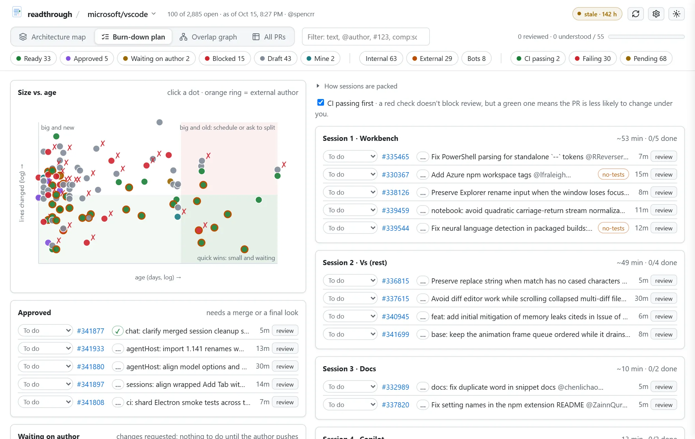
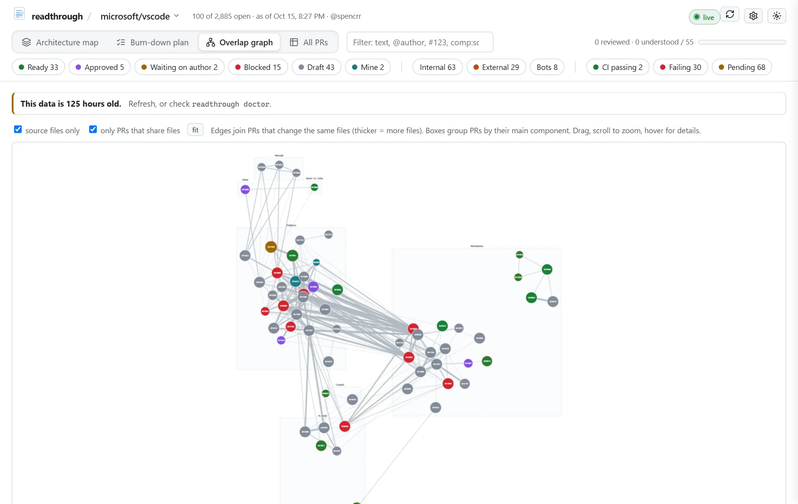
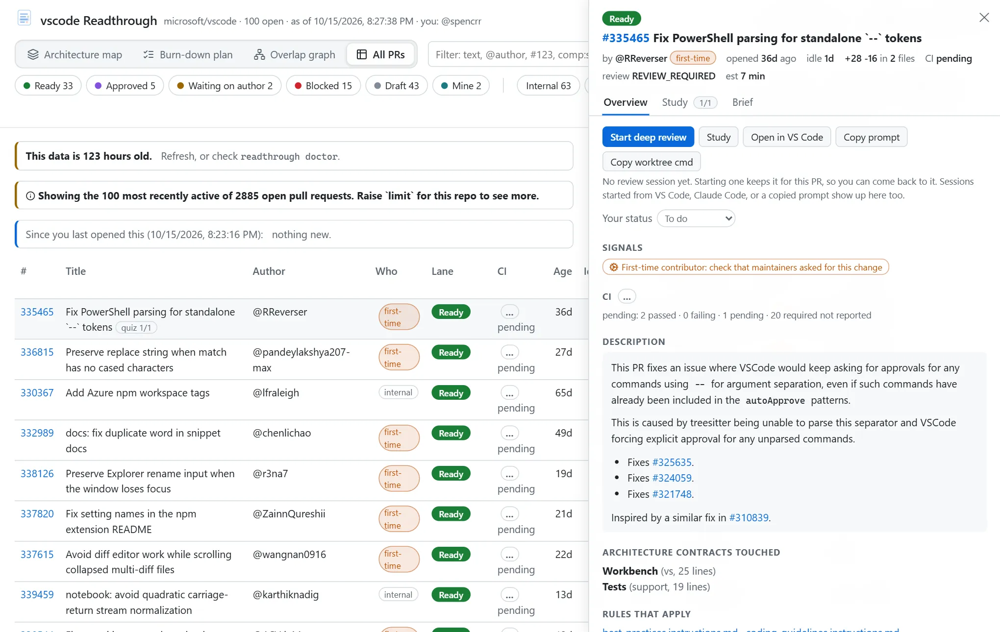

# Using readthrough

This guide walks through a normal week with the tool: setting it up, onboarding a repo, reading the dashboard, running a deep review, and keeping it fresh without thinking about it. The last sections cover configuration and troubleshooting.

There are two ways to run it. The **live dashboard** is a small local server that refreshes every repo and updates the page as things change; if it can't refresh, it keeps the last good data and says how old it is. The **snapshot** is a single HTML file per repo that you rebuild when you want. Both show the same thing. I run the live one.

## Setting it up

Install it as a uv tool so `readthrough` is on your PATH. `[study]` adds the Copilot SDK, one of the model runtimes the study assistant and model-assisted onboarding can run on; the Anthropic and OpenAI runtimes need nothing installed, only an API key (see [Studying a PR](#studying-a-pr)). Leave it off if you don't want a model at all: the dashboard, briefs, deep reviews, and the rules-based study assistant all work on the standard library alone.

```sh
uv tool install "readthrough[study]"
```

Releases on PyPI are built by the repository's release workflow from a tagged commit, with signed provenance; `gh attestation verify <downloaded file> --owner spencrr` checks one. For the latest `main` instead, install from the repository: `uv tool install "readthrough[study] @ git+https://github.com/spencrr/readthrough"`.

To work on the tool itself, clone it and install it editable, so edits take effect right away:

```sh
git clone https://github.com/spencrr/readthrough.git ~/src/readthrough
uv tool install -e "~/src/readthrough[study]"
```

If the live server is running, stop it before reinstalling (`readthrough uninstall server`, then `install server` again afterwards). Windows won't let uv replace files the server has open.

Then run the installers. Each one is optional and can be undone with `readthrough uninstall <same thing>`.

- `readthrough install skill` copies the deep-review instructions into each installed agent's skill directory: `~/.agents/skills/readthrough` for the Copilot CLI and VS Code's agent sessions, `~/.claude/skills/readthrough` for Claude Code (`--agent claude` for just one). Re-run it after pulling changes; `doctor` warns you when an installed copy is out of date.
- `readthrough install server` starts the live dashboard now and again every time you log in. Open it with `readthrough open`, or bookmark <http://127.0.0.1:8765/>.
- `readthrough install schedule` creates a Task Scheduler entry that refreshes every repo in the morning and opens the dashboard when something needs you. More on this below.
- `readthrough install protocol` registers a `readthrough://` link handler for your Windows user, so the buttons in the snapshot version can start a review. The live dashboard doesn't need it. No admin rights are needed; it writes a single key under `HKCU\Software\Classes`.

None of this does anything until you onboard a repo. With the server running, its front page takes you to onboarding.

## Onboarding a repo

readthrough won't lay out a repo's PRs until it knows the repo's architecture. That knowledge lives in a **profile**: a TOML file listing the layers and components, which paths belong to each, what each component is responsible for (and what it isn't), and which changes deserve a closer look. Everything on the dashboard hangs off it. The map rows are its layers, the brief's contracts are its components, and the questions Copilot asks come from it. A bad profile gives you a confidently wrong picture, so onboarding makes you look at it before it counts.

You can onboard from the browser or from a terminal; they do the same thing and write the same files.

### From the browser

With the live server running, open <http://127.0.0.1:8765/setup>, or pick **+ Onboard a repo…** from the repo switcher in the dashboard's header. (With nothing onboarded yet, the front page takes you there.) The page walks through it in order:

1. **Which repo?** Pick where it lives (GitHub unless you say otherwise), type its name (`owner/name`; `organization/project/repository` on Azure DevOps), pick the gh account that can see it if you have more than one, and check access. Expand **connection details** to see what reads the repo (the `gh` CLI for GitHub; the platform's REST API elsewhere) and where the credential comes from, in the order tried (`AZURE_DEVOPS_EXT_PAT`, then `az`, then anonymously, on Azure DevOps). After the check, the step says which one was actually used. readthrough stores no token and never prompts you to sign in; when it has no credential, `doctor` says what to run.
2. **Your local clone.** It guesses from `~/src` and `~/repos`; check it, and pick the remote PRs should be fetched through.
3. **Its architecture profile.** Use one that already exists (the repo's own `readthrough.toml`, or one from a shared profile directory), draft one from the file tree, or have a model draft one (the button names the runtime it would use). Progress shows as it runs.
4. **Check it, edit it, accept it.** The profile's TOML is on the left, and the report on the right re-checks as you type: coverage against recent PRs, anything blocking acceptance, the paths that aren't mapped yet (each with a **+ component** button that adds a stub for it), the busiest components, and how recent authors classify, with an override for anyone who's wrong. **Preview the map** opens the dashboard as it would look, without touching anything live. **Accept and start** finishes, and the server starts serving the repo straight away.

Each step shows the matching terminal command.

### From a terminal

Start with:

```powershell
readthrough onboard pallets/click
```

This does four things:

1. It records the repo in `~/.readthrough/config.toml`, finds your local clone (it looks in `~/src` and `~/repos`; pass `--clone` otherwise), and works out which git remote points at the repo.
2. It looks for a profile someone already wrote: a `readthrough.toml` in the repo itself (in `.github/` or at the root), or a file in one of your shared profile directories (see [Where profiles come from](#where-profiles-come-from)). If there isn't one, it drafts one from the file tree, CODEOWNERS, any architecture or contributing docs, and where the last hundred merged PRs actually changed code. The draft goes to `~/.readthrough/repos/github/pallets/click/profile.toml`.
3. It measures the profile against those hundred PRs and prints a report: how much of the changed code maps to a real component instead of "other", the busiest components, the biggest unmapped paths, and how recent authors would be classified.
4. It lists anything that blocks acceptance.

Run it again after each edit to re-check. Acceptance requires that:

- at least 85% of recently changed lines land in a named component;
- no path pattern matches nothing (usually a typo, or a directory that moved);
- no component is completely shadowed by an earlier one (the first matching component wins, so order matters);
- the profile has an `[authors]` section, even an empty one, so you've looked at who counts as internal.

When you want to see it, `--preview` builds the dashboard with the draft and opens it, with a banner saying it's a preview. When the checks pass, `--accept` finishes:

```powershell
readthrough onboard pallets/click --preview
readthrough onboard pallets/click --accept
```

`--force` accepts despite problems, if you know better.

### Letting a model draft it

The plain draft is mechanical: it turns directories into components. That's fine for repos laid out by responsibility and poor for everything else. Click, for instance, keeps its whole library in one flat `src/click/` folder, so the plain draft gives you a single "Click" component.

```powershell
readthrough onboard pallets/click --assisted
```

This starts a conversation on the configured model runtime (`runtime` in `config.toml`: GitHub Copilot through the Copilot SDK, or Claude or OpenAI through their APIs; see [Studying a PR](#studying-a-pr)) that reads the repo and writes the profile itself. It can list directories, read files, search the code, check which files a pattern matches, and propose a profile. Every proposal goes through the same checks as `--accept`, and the results go back to the model so it can fix what's wrong. It can't edit anything or run commands. For click, Copilot split the package into eleven components across six layers (the decorator API, the command model, argv parsing, types, terminal UI, help formatting, completion, and so on), with `does_not_own` notes that name the neighbouring component, and then told me which split it was least sure of.

Read what it wrote anyway. It only writes responsibilities it could back up from the code or docs, but it's still a draft, and you're the one who'll be relying on it. The profile's first line says which model drafted it and through what, and its `drafted_by` key says `model`, so anyone reading the map later knows what to double-check. The previous profile is kept next to it with a timestamp.

[Writing a profile](profiles.md) explains each part of the file and how to make a good one.

### When the map drifts

Repos change shape. If a build finds that less than 75% of the open PRs' changes land in a named component, the dashboard shows a "map is drifting" banner listing the unmapped paths, and `doctor` flags it. `readthrough onboard OWNER/NAME --update` redrafts your local profile (keeping a backup), or you can add the missing components by hand.

### More than one repo

Onboard as many as you like. In the browser, the gear button next to the repo switcher opens that repo's settings (see [Configuration](#configuration)). From a terminal, `readthrough repos` lists them, `readthrough default OWNER/NAME` picks the one commands use when you leave out `--repo`, and `readthrough remove OWNER/NAME` stops tracking one (`--purge` also deletes its data). The live server serves all of them, each at `http://127.0.0.1:8765/r/OWNER/NAME/`, with a switcher in the header, and picks up newly onboarded repos without a restart.

Every command takes `--repo`:

```powershell
readthrough --repo pallets/click build --open
readthrough --repo pallets/flask review 5600
```

### Accounts

readthrough talks to GitHub through the `gh` CLI, so whichever account `gh` uses is the account the dashboard sees. That decides two things: PRs you authored land in the "Mine" lane, and PRs that request your review go to the top of the plan.

If you're signed in to more than one account (say, a personal one and an enterprise managed user for internal repos), tell onboarding which one can read the repo:

```powershell
readthrough onboard my-org/internal-service --account me_corp
```

From then on, every GitHub call for that repo uses that account's token (`gh auth token --user me_corp`), whatever account `gh` has active. Run `gh auth login` once for each account first.

I considered signing in through the browser instead, but that would need readthrough's own OAuth app, which every organization owner would have to approve before it could read their private repos, plus a client secret to keep somewhere. `gh` is already approved, already signed in, and already handles enterprise SSO.

## Checking the setup

```powershell
readthrough doctor
```

The first half checks the machine: `gh` and which accounts are signed in, the review agent and each installed agent's copy of the skill, the link handler, the scheduled task, the live server, which study assistant is in use, and which terminal reviews will open in. Then it checks each repo: whether the account can read it, the clone and its remote, where the profile comes from, whether it's onboarded, how old the last build is, what the last build had to do without, whether the map is drifting, and whether the live server's last refresh failed. Anything that's off comes with the command that fixes it.

`readthrough doctor --bundle` writes a zip to `~/.readthrough/bundles/` with what someone else needs to debug a problem: your config, the recent logs, the versions of readthrough, Python, `gh`, and Copilot, the live server's health, and a summary of each repo's last build. It holds no tokens (those stay in `gh`'s own store), but it does name your repos, accounts, and paths, so look before you share it.

## The dashboard

`readthrough open` opens the live dashboard if the server is running, otherwise the repo's latest snapshot. Without the server, `readthrough build --open` fetches everything and opens `~/.readthrough/repos/FORGE/OWNER/NAME/index.html`. The first build takes about a minute for a busy repo because it downloads every diff. After that, diffs are cached by commit, so only PRs that changed get fetched again.

The theme button in the corner (sun, moon, or both) cycles through auto (follows your OS), light, and dark. The panel that opens when you click a PR can be resized by dragging its left edge; double-click the edge to reset it. Both settings stick. The browser tab's icon shows how many PRs are waiting on you (your review requested, or a re-review), so you can see it from another tab.

The chip beside Refresh reports the connection and the last refresh: live, refreshing, offline, or refresh failed. If the data is older than the freshness threshold, it reads **stale · 5 h**, or adds the age to the more urgent state (**offline · 5 h**, for example). Hover for details and the next check. A refresh error still gets a banner; a snapshot keeps its age warning above the map.


Every PR lands in one lane, shown as the colored pills at the top. Clicking a pill shows only that lane; click it again to show everything. Ctrl-click (⌘-click on a Mac) adds or removes one lane, so you can build "Ready and Approved". The author and CI pills work the same way, independently. While anything is filtered, a blue "Only … · show all" chip says what, and clears it. Filters and the search are part of the page's URL, so a view like "only my PRs" can be bookmarked.

- **Ready**: needs a review and nothing is blocking it. This is the lane you burn down.
- **Approved**: someone approved it, so it needs a merge or a final look.
- **Waiting on author**: changes were requested and the author hasn't pushed since. Nothing to do yet.
- **Blocked**: merge conflicts, or a required check failing because of this PR. A nudge to the author helps more than a review.
- **Draft** and **Mine** are self-explanatory.

If an author pushes after someone requested changes, the PR moves back to Ready with a `re-review` tag, because that's usually the most useful review you can do.

### Internal and external authors

Next to the lanes are pills for the kinds of author: **Internal**, **External**, and **Bots** by default. The profile's `[authors]` section decides who's who, in this order:

1. Bots: GitHub App accounts, logins ending in `[bot]`, and anything listed under `bots`.
2. The profile's `internal` and `external` login lists, plus the `internal_authors` and `external_authors` you set for the repo in your own config (handy for a contractor, or someone who left).
3. Membership of the teams and orgs in `internal_teams` and `internal_orgs`. Each author is checked individually and the answer is cached for a week, so this works for orgs far too large to list. Checking team membership needs a `gh` token with `read:org`.
4. GitHub's author association: owners, members, and collaborators are internal, contributors are external, and someone with no association yet is a first-time contributor.

On the map, an orange dot on a chip marks an external author, and a hollow orange dot marks a first-time contributor. In lists and the PR panel the author has a small badge, and in the overlap graph external PRs have an orange ring (dashed for first-timers). Each kind can carry its own signal and review questions; by default, external PRs remind you to read new dependencies, network calls, file writes, and subprocesses closely, and first-time PRs nudge you to check whether maintainers asked for the change. Search with `is:external`, `is:first-time`, `is:internal`, or `is:bot`.

During onboarding, the report lists how the last hundred PRs' authors classify, so you can check this before it matters.

### CI

GitHub's overall CI status is too blunt to act on, so each PR's checks are sorted into one of these:

- **failing (required)**: a required check fails, and it doesn't fail on the base branch. That's the PR's problem, so the PR goes to Blocked.
- **not run**: none of the required checks reported on the latest commit. This is common for PRs from forks that are waiting for a maintainer to approve the workflows. GitHub's own rollup calls these "success" when the only thing that ran was a CLA bot, which is misleading.
- **optional check failing**: only checks that aren't required fail. It's a warning, not a blocker.
- **failing on main too**: everything that fails also fails on the base branch's latest commit. Not this PR's fault.
- **pending**, **passing**, or **no CI**.

Required checks come from the base branch's protection rules and rulesets, which anyone who can read the repo can see. Re-runs are collapsed, so only the latest result of each check counts.

Each row has a CI badge (✓, ✗, !), and hovering it lists the failing checks. The **CI passing / Failing / Pending** pills filter like the lane pills, and `ci:failing`, `ci:passing`, `ci:pending`, `ci:not-run`, and `ci:main` work in the search box. In **All PRs**, the CI column sorts by urgency rather than alphabetically. The burn-down plan puts green PRs first in each session (untick **CI passing first** to turn that off), because a green PR is less likely to change under you. The PR panel lists each failing check with a link to its log and whether it's required or also failing on the base branch.

### The views

The **Architecture map** is the main view. Each row is a layer from the profile, each box a component with matching PRs. Components without any share a thin **No matching PRs** row in their layer, so the architecture stays visible without a grid of empty boxes. Each chip is a PR, placed in every component it touches and sized by how much it changes. Hover over a chip and all its other placements light up. A PR that lights up four layers is the kind that tends to blur responsibilities. An outline marks the component where most of the change lives. Click a component to filter everything else down to it; click again to clear it. Empty components work the same way, including from the keyboard with Enter or Space, and stay reachable even when no PR matches.

The bar along the bottom of each component shows how much is changing there. Its length is the component's changed lines compared with the busiest component's, and its colors split those lines by lane, so a long mostly-red bar is a busy component whose PRs are blocked. Hover it for the numbers.

The **Burn-down plan** is the to-do list.



Ready PRs are packed into sessions of about an hour, and each session stays inside one component, so you build context instead of switching it. Your requested reviews and re-reviews come first, then small quick wins, then the oldest. The chart on the left plots size against age. Small, old PRs in the bottom right are the cheapest to clear.

The **Overlap graph** connects PRs that edit the same files, with each PR boxed inside its main component. Clusters are worth reviewing together, and they're also where the merge-order fights will happen. Drag nodes around, scroll to zoom, and hover a node to fade everything it isn't connected to. Hovering an edge lists the shared files. By default it ignores the paths the profile calls non-source (tests, docs, lockfiles), which otherwise connect everything to everything, and hides PRs that share nothing. Underneath is a list of hot files. When seven open PRs touch the same module, whichever lands first makes the other six rebase.



**All PRs** is a sortable table. The search box understands `@author`, `#1234`, `comp:<component id>`, `flag:<signal id>`, `is:external`, and `ci:failing`, and you can combine them.

Clicking any PR opens a side panel. **Overview** has its signals, the description (rendered the way GitHub shows it), the contract for each component it touches, the repo's instruction files that apply, related PRs, unresolved review threads, and the files. **Study** is covered below. **Brief** shows the same study brief the deep review reads.

### What's worked out by rules, and what a model wrote

Almost everything on the dashboard is computed, not generated:

| What | Where it comes from |
| --- | --- |
| Lanes, CI, review state | The forge |
| Which component a file belongs to | The profile's path patterns (first match wins) |
| Signals and line heuristics | Forge facts, the profile's rules, and readthrough's own checks with thresholds from the profile |
| Contracts | Quoted from the repo's architecture doc, or written in the profile |
| Plan, estimates, overlaps, related PRs | Arithmetic over the above |
| The Study tab's conversation | The model assistant (each entry names the model and the runtime), or the rules assistant from the profile's questions |
| Review sessions | The review agent (the Copilot CLI or Claude Code) |
| The profile itself | Whoever drafted it: readthrough's file-tree draft, a model (the file's first line says which), or a person (its `drafted_by` key says which) |

Each signal shows a small icon for where it came from (the forge, or a cog for a rule) and, on hover, the exact rule: the path pattern, the regex, or the threshold. The PR panel's Overview ends with the same summary, and the map's legend names the profile, who first drafted it, and when you accepted it. Anything a model wrote in the Study tab carries a ✦ and the model's name.

### What the signals mean

Signals are hints about where to look, not verdicts. A few are hard facts: merge conflicts, failing CI, no tests for a sizeable change, a PR spanning many layers. The rest come from the profile: paths that deserve care (migrations, public exports, dependency manifests) and patterns in added lines that often mean trouble in that particular repo. For example, an async function missing the `_async` suffix a repo's style guide requires, or a transport writing to the store when the profile says the pipeline owns persistence. They're tuned to stay quiet, but they will still sometimes be wrong. The deep review checks each one against the actual code.

### Tracking progress

The plan's rows have a status menu, and the PR panel has the same choices as pills under **Your status**: to do, understood, reviewed, commented, approved, changes requested, or skipped. The progress bar counts understood and reviewed PRs. On the live dashboard the status is saved straight to the repo's `ledger.json`, the same file deep-review sessions write when they finish, so a session ticking a PR off shows up on the page within a few seconds. The controls pause while a save is pending; a failed save says why and keeps the previous status. **To do** clears only the status, not your note or linked review session. On the snapshot it's kept in your browser, and the ledger is merged in on the next build. Either way, the status is pinned to the commit you reviewed. If the author pushes again, the status resets and the PR shows up under "Changed since your review."

## Deep reviews

This is the part that's meant to slow you down a little.

Press **Start deep review** on a PR (or run `readthrough review 2897`). A new terminal opens with an agent session in your clone, already working on that PR. Which agent is up to you: by default the Copilot CLI if it's installed, else Claude Code, and `agent = "claude"` in `config.toml` picks one, with its options under `[agents.claude]`. Which terminal is up to you too: by default it's the first one found for your platform (Windows Terminal, then a plain console; Terminal.app; `x-terminal-emulator`, then GNOME Terminal), and `terminal = "wt"` in `config.toml` names one, with its options under `[terminals.wt]` (see [Configuration](#configuration)). `readthrough review 2897 --here` runs the session in the terminal you're already in.



The session follows a fixed routine:

1. It reads the repo's profile and the PR's brief, checks out the PR in a separate worktree under `~/.readthrough/repos/FORGE/OWNER/NAME/worktrees`, reads the diff and the rules that apply, and quietly writes up its own findings. Your own checkout and branches aren't touched.
2. It shows you only the title and summary, and asks what you think the riskiest part is and what test you'd want to see.
3. It walks the change in reading order, the order the profile lists components in. After each chunk it asks you one question tied to a component's contract or one of the repo's rules. Get it wrong and you get a hint, not the answer.
4. You explain the whole PR back in a few sentences, and it tells you what you missed.
5. You list your concerns. Only then does it show its own, side by side, with file and line evidence so you can argue. If something is in dispute, it can run the tests in the worktree, with the test command from the profile, to settle it.
6. It drafts review comments from the points you agreed on, in your voice, following the profile's review guidance. It posts nothing until you approve the exact text, and then it records the outcome in the ledger.

Each PR gets its own session, and the session ID comes from the PR, so pressing the button again later resumes the same conversation instead of starting over, in whichever agent it was started in. A small dot next to a PR means a session already exists. On the live dashboard, the dot turns green and pulses while a Copilot session is open in a terminal or in VS Code; Claude Code leaves no trace of an open session, so for its sessions the panel shows when they were last written instead of claiming they're closed. If you want a clean slate, run `readthrough review 2897 --fresh`.

**Open in VS Code** uses VS Code's agent links (VS Code 1.138 or newer). For a PR that already has a Copilot session, it opens the latest one in the Agents window. These are the same Copilot sessions, so you can start in the terminal and continue in the editor. For a new PR, it opens a fresh agent session with the prompt filled in, and you press send. VS Code deliberately never sends a message from a link.

Sessions are linked to their PR wherever they started. Every prompt readthrough writes, including the one behind **Copy prompt**, begins with a marker like `[readthrough:github/pallets/click#2897]`, and the server links any session of any installed agent whose first message carries one to that PR. So a review you start from VS Code, or by pasting the prompt into Claude Code, shows up in the PR panel next to the terminal one. The panel lists every linked session, which agent and where it ran, and when it was last active, and can resume any of them in a terminal (in its own agent) or open a Copilot one in VS Code. The index of linked sessions is kept in `~/.readthrough/session-index.json`; the first scan reads every session you have, and later scans only read new ones.

**Copy prompt** is the fallback for anywhere else you run an agent. It and **Copy worktree cmd** are under **More review actions (⋯)** in Overview. Enter or Space opens the menu, Tab reaches the copy buttons, and Escape closes the menu before closing the panel.

To burn down a whole session, ask Copilot for "burn down session 2 of OWNER/NAME". It gives you a quick overview of how the PRs in that session relate, then runs the routine for each one.

## Studying a PR

The deep review is a long, guided conversation in a terminal. The **Study** tab in the PR panel is the lighter version, right in the dashboard, for building understanding a question at a time. It needs the live dashboard.

Two assistants can sit on the other side of it, and `readthrough doctor` tells you which one you have. The **model assistant** (`assistant = "model"`) reads the PR's code, asks questions about what it finds, and grades your answers with file and line evidence. It runs on whichever **model runtime** you have: the Copilot SDK (the `[study]` extra; GitHub Copilot through its sign-in, or a provider of your own), Anthropic's API with a key, or OpenAI's (OpenAI itself, or Azure OpenAI and Foundry with a key or an Entra sign-in). Without any of those, it's the **rules** assistant, which needs nothing installed: it asks the questions the repo's profile already carries (the shared ones, each touched component's, the author kind's, and one per signal), points you at files for hints, and assembles a briefing from the PR's metadata. It never grades, because it has no answer key and a self-awarded "correct" isn't evidence; instead, after you've answered the last question about a component, it shows that component's contract once so you can check yourself, and the box offers a "what I missed" note. `assistant = "rules"` in `config.toml` picks it even when a runtime is available. The rest of this section describes the model assistant; the stages, the log, and the brief are the same for both.

The runtime is a machine-wide choice, `runtime = "auto" | "copilot" | "anthropic" | "openai"`, where `auto` takes the first that can run (the Copilot SDK when installed, else a runtime whose key is set). Each has a `[runtimes.NAME]` table; the key itself never goes in the config, only the name of the variable holding it:

```toml
runtime = "openai"

[runtimes.copilot]                                        # the Copilot SDK; GitHub Copilot unless provider is set
# provider = "anthropic"                                  # openai, azure, or anthropic: a provider of your own, no GitHub sign-in
# base_url = "https://api.anthropic.com"
# model = "claude-sonnet-5-5"
# api_key_env = "READTHROUGH_MODEL_API_KEY"

[runtimes.anthropic]                                      # Claude, straight to the Messages API
model = "claude-sonnet-5-5"
api_key_env = "ANTHROPIC_API_KEY"

[runtimes.openai]                                         # OpenAI, or Azure OpenAI / Foundry
base_url = "https://my-resource.openai.azure.com/openai/v1"
model = "gpt-4.1"                                         # on Azure, the deployment name
entra = true                                              # Azure only: an Entra token from the signed-in az instead of a key
```

A repo's `study_model` still wins over the runtime's model. With `entra = true` the token comes from `az` whenever a call needs one, which is how Azure OpenAI resources with key auth disabled by policy are reached. Every entry the assistant writes records the model that wrote it (as the runtime reported it) and the runtime that carried it, and the brief names them ("assessed by gpt-4.1 via openai"), since a verdict's weight depends on who gave it; both come from the entry, so changing runtimes never relabels an old grade. The onboarding drafter (`--assisted`, and the setup page's **Draft with a model**) runs on the same runtime, so it can draft with Claude or GPT too.

Every model call, whoever pays for it, is one line in the repo's **usage ledger** (`usage.jsonl` in its data directory): the model, the tokens in the provider's own units, Copilot's premium-request multiplier and AI-credit consumption when it was Copilot, and who was billed (`copilot:<login>`, `anthropic:api.anthropic.com`, `azure:<resource host>`). Nothing is converted into anything else, and a quantity the provider didn't report is left out rather than written as zero. `readthrough doctor` sums the last thirty days per repo.


It's one conversation with a single box underneath, and a small indicator at the top shows how far you've got: Predict, Quiz, Teach back. What the box does follows where you are:

1. **Predict.** Until you've predicted, the box saves your prediction: what you expect the PR to touch, what's riskiest, and what test you'd want. You'll compare later, and it's kept as evidence. **Skip** goes straight on, and the log notes that you skipped.
2. **Talk, quiz, or get briefed.** After that, the box sends messages: ask anything, or argue a point. **Quiz me** has the model read the diff and the surrounding code and ask one question about the intent, the control flow, which component should own what, the unhappy paths, or whether the tests would catch a regression. While a question is open, the box answers it, and **Hint** asks for a nudge. The model grades each answer *correct*, *partial*, or *incorrect* with file and line evidence, and for anything short of correct gives a hint rather than the answer; afterwards you can open "What a good answer covers". **Brief me** asks for a short summary of the change and the things most worth a reviewer's attention, with file and line references. It's there when you'd rather be oriented first, and the log records that you asked and whether it was before the quiz, so the evidence shows what you were told versus what you worked out. Also after the prediction, **What to look at** lists the PR's signals, line heuristics, the main component's contract, the biggest files, and the PRs it shares files with, all worked out by rules.
3. **Teach back.** Write a few sentences explaining the whole PR as if briefing a teammate, and press **Teach back**: the model names the gaps.

Tab moves from the box to its buttons, and Ctrl+Enter runs the main one. To keep something, **pin** any message, yours or the model's, and it goes into the brief. A line under the transcript says what's answering (the configured model, or the runtime when GitHub Copilot picks the model per call), and each reply is labelled with the model that actually wrote it.

Everything you write and everything the assistant concludes goes into the PR's **study log**, an append-only record in the repo's `study/` folder. Nothing in it is ever edited or deleted, and every entry says who wrote it: you, the model (and which model, through which runtime), or the rules. When a turn fails (the provider unreachable, the clone missing a commit), the log records that too, against the runtime rather than a model that never answered, so a request without a reply is never mistaken for one you abandoned. Each answer is tagged, from the log itself, with whether a hint or a briefing came before it. The log is rendered as the last section of the brief, so the evidence travels with it: the terminal deep review reads it, and the **Brief** tab shows it. Your quiz score shows next to the PR in the plan and the table; with the rules assistant there is no score, only how many questions you answered and how many of those were unaided.

**What the model can do here.** Each PR gets its own conversation, separate from the deep-review session. On the Copilot SDK it lives in the CLI's session store and survives server restarts; on the API runtimes a restart starts a fresh conversation, which is handed the brief and so the study log's evidence. It runs in the PR's worktree, but with every built-in tool switched off and permission requests refused. It has eight tools of its own. Three read the code: the diff, a file, and a search. Five append to the study log: ask a question, assess an answer, assess a teach-back, add a note, record a finding.

**Taking it into a deep review.** The study session and the deep-review session are separate on purpose: they have different tools and different rules (study can't edit or run anything), so resuming one as the other wouldn't fit. What carries over is the evidence. The study log's section of the brief starts with a **Handoff** line (solid on, revisit, unanswered, and teach-back gaps), and the deep review reads it first and spends its time on the weak spots. The study assistant can't edit files, run commands, or reach the network beyond its own provider. File reads are confined to the worktree. If the profile has study guidance, the model gets that too.

From a terminal, `readthrough study 2897` prints the log, and `--prediction`, `--teachback`, `--note`, and `--finding "major: summary" --at path:line` add to it. The deep-review skill uses these too, so a terminal review and the dashboard build the same record.

### Why a link handler?

This only matters for the snapshot. On the live dashboard, the buttons call the local server, which starts the terminal itself.

A page opened from disk can't run programs or talk to anything on your machine. A custom URL scheme is the standard way around that, the same mechanism `mailto:` uses to open your mail client. The snapshot's buttons are plain links like `readthrough://review/pallets/click/2897`. Windows hands them to `readthrough handle-url`, which validates them and opens the terminal.

Any web page can try to open a link like that, so the handler is strict. It accepts three actions (`review`, `refresh`, `open`), a numeric PR number, and only repos you've onboarded. It never puts link text into a shell command. The browser also asks for confirmation the first time; tick "always allow" if it's offered.

## Keeping it fresh

### The live dashboard

`readthrough install server` runs `readthrough serve` in the background whenever you're logged in. It refetches each onboarded repo's PRs every 10 minutes, and the **refresh** button does it on demand. While a page is open, the server pushes changes to it as they happen:

- new data after each refresh, without losing your tab, filters, or open PR;
- ledger changes, whether they come from the status menus, a deep-review session, or `readthrough ledger` in a terminal;
- Copilot sessions opening and closing.

The **● live** badge in the header shows the connection. It turns grey if the server goes away and reconnects on its own when it's back. The server also picks up builds made from the command line, so `readthrough build` and the scheduled task both feed the open page. It watches `config.toml` too: onboard a repo and it appears, remove one and it goes.

To run it in a terminal instead, use `readthrough serve --open`. Ctrl+C stops it.

The server listens only on `127.0.0.1`, and it is careful about other websites, since any page in your browser can send requests to localhost. It only answers requests addressed to `127.0.0.1` or `localhost`, which blocks DNS-rebinding tricks. Anything that changes state (a review, a refresh, a status, a setting) needs a random token that changes every time the server starts and is only readable by the pages the server itself served. A request from another site gets a 403. Only one copy can run at a time; a second `serve` notices the first and exits.

PR descriptions and review comments are written by people outside your team, and they're shown as rendered HTML, so the page is careful with them too. The HTML is GitHub's own rendering, it's sanitized again with DOMPurify before display, and the page's content security policy only runs scripts carrying a random value that changes on every load. Anything that slipped through would still have no way to run.

### The morning nudge

The scheduled task runs `readthrough build --all --open auto`. In `auto` mode a repo's dashboard only opens when something new needs you since you last looked: a review request, a re-review, new commits on a PR you already reviewed, or new PRs. On quiet mornings it updates silently. "Since you last looked" means the last time you opened that dashboard, not the last refresh, so it still works when the live server is refreshing every few minutes. The banner at the top of the page uses the same comparison.

```powershell
readthrough install schedule                                   # weekdays at 08:30, opens when there's news
readthrough install schedule --at 07:45 --days daily           # every day
readthrough install schedule --open always                     # open every time
readthrough install schedule --open never                      # just keep the data fresh
```

The task runs as you, and only while you're logged in, because it opens a browser window. If the machine was asleep at 08:30, it runs as soon as it wakes up. It runs windowless, so nothing flashes on screen. When the live server is running, it opens the live page instead of the snapshot. Output goes to `~/.readthrough/readthrough.log`. If the data is ever more than a day old (two hours for the live page), the dashboard shows a warning at the top.

To see when it last ran and when it will run next, use `readthrough doctor`.

On macOS or Linux, the install commands print a crontab line, or tell you to run `serve` from launchd or systemd.

## Configuration

Onboarding writes the config for you. To change it, use the repo's settings page (the gear button in the dashboard's header, or <http://127.0.0.1:8765/setup>), or `readthrough config --edit` to open the file; `readthrough config` shows the effective values.

The settings page covers the gh account, clone, and remote; session length, PR limit, and study model; per-author overrides (pick from the table of recent authors); the profile (edit your local copy, **Customize** a shared or in-repo profile into a local copy, or **Propose upstream**, which opens the forge's new-file page for `readthrough.toml` in its dot-directory with your profile filled in, or copies the profile for you where the forge has no such page); the default repo and refresh interval; and removing a repo. A few things stay command-line only and are shown read-only there: `agent_args` (passed straight to a program the server launches), the `profile` path override (makes the server read an arbitrary file), the terminal, agent, and assistant choices, and the port (changing it from the page you're on would break that page). If the file changed since the page loaded it, saving asks you to reload rather than overwrite.

The file lives at `~/.readthrough/config.toml`:

```toml
default_repo = "pallets/click"     # used when you leave out --repo
port = 8765                        # live server
refresh_minutes = 10               # live server refresh interval
terminal = "auto"                  # where deep reviews open: auto, wt, console, terminal-app, x-terminal-emulator, gnome-terminal
assistant = "auto"                 # who answers in the Study tab: auto, model (needs a runtime), rules
runtime = "auto"                   # the model it runs on: auto, copilot (the SDK), anthropic, openai
agent = "auto"                     # which agent runs deep reviews: auto, copilot, claude

[agents.claude]                    # options for one review agent
extra_args = ["--model", "opus"]

[terminals.wt]                     # options for one terminal launcher
profile = "PowerShell"

[profile_sources.shared]           # directories holding <owner>/<name>.toml profiles your team shares
dirs = ["~/src/team-profiles"]

[defaults]                         # applies to every repo unless the repo overrides it
session_minutes = 60

[[repos]]
name = "pallets/click"
clone = "~/src/click"
remote = "upstream"
onboarded = "2026-10-03T03:10:46+00:00"

[[repos]]
name = "my-org/internal-service"
account = "me_corp"
internal_authors = ["contractor-login"]
agent_args = ["--model", "claude-opus-4.8"]
```

`terminal`, `assistant`, `runtime`, and `agent` are choices for the whole machine, and so are the `[terminals.*]`, `[assistants.*]`, `[runtimes.*]`, `[agents.*]`, `[forges.*]`, and `[profile_sources.*]` option tables. Each name and each option is checked when the file is read: a typo fails with a suggestion rather than being ignored, and relative paths in options are taken from the config file's directory.

Per-repo keys, which can also go under `[defaults]`:

| Key | What it does |
| --- | --- |
| `clone` | Your local clone. Reviews, worktrees, and onboarding's file tree come from it. |
| `remote` | The git remote that points at the repo. Detected if left out. |
| `account` | The `gh` account to read the repo as. |
| `profile` | Path to a profile file, overriding every other source. |
| `onboarded` | When you accepted the profile. Builds refuse to run without it. |
| `session_minutes` | How long each burn-down session should be (default 60). |
| `limit` | The most open PRs to fetch (default 100). |
| `internal_authors`, `external_authors` | Logins to force into a kind, on top of the profile's lists. |
| `study_model` | The model for the study assistant and model-assisted onboarding, overriding the runtime's. |
| `agent_args` | Extra arguments for the review agent, for this repo. For example, `["--model", "claude-opus-4.8", "--remote"]` makes Copilot pick a model and lets you continue the session from GitHub on your phone. |

Paths under your home directory are written as `~/...`, so the file works on another machine or account. To keep it somewhere else, in a dotfiles repo for instance, point `READTHROUGH_CONFIG` at it; the data still goes to `~/.readthrough` (or `READTHROUGH_HOME`). The `schema = 2` line at the top lets a future version recognize the file's layout. Leave it as is.

The server notices config changes on its own. Port changes need a restart (`readthrough uninstall server`, then `install server`).

Everything the tool writes lives in `~/.readthrough` (or wherever `READTHROUGH_HOME` or `--home` points): `config.toml` and `readthrough.log` at the top, and one folder per repo under `repos/FORGE/OWNER/NAME/` (`repos/github/microsoft/vscode/`) with its profile draft, the dashboard, `data.json`, the briefs, the ledger, the study logs, the diff cache, and the worktrees. Deleting a repo's folder resets that repo; deleting `~/.readthrough` resets everything except the installers. Remove those with `readthrough uninstall`.

### Repos on other forges

A repo's entry says where it lives with `forge = "gitlab"`, `"forgejo"` (Codeberg and other Forgejo or Gitea servers), or `"ado"` (Azure DevOps, named `organization/project/repository`); GitHub is the default and needs no key. `readthrough onboard --forge gitlab gitlab-org/cli` writes the entry; everywhere else a repo is named by `--repo`, a plain name works unless the same name is onboarded on two forges, when the full `gitlab/gitlab-org/cli` form (the repo's *slug*, which is also its path in the dashboard URL and under `repos/`) says which.

GitHub repos are read through `gh`, which carries your sign-in. The other forges are read through their REST API with a token from the platform's own CLI when it's installed and signed in (`glab` for GitLab, `az` for Azure DevOps), else from an environment variable (`GITLAB_TOKEN`, `FORGEJO_TOKEN`, `AZURE_DEVOPS_EXT_PAT`), else anonymously, which is enough for public repos. Hosts and variable names are the `[forges.NAME]` tables; tokens themselves never go in the config:

```toml
[forges.gitlab]
host = "gitlab.example.com"          # a self-hosted instance (gitlab.com by default)
credential_env = "GITLAB_TOKEN"      # the variable to read a personal access token from

[forges.forgejo]
host = "codeberg.org"
```

gitlab.com throttles anonymous API use per IP address quite hard, so a token (or `glab auth login`) makes a real difference there.

On Azure DevOps, readthrough first asks the organization which Entra tenant it belongs to (an anonymous call the organization refuses, naming the tenant), then asks `az` for a token *in that tenant*. That matters when you're signed in to several: `az` holds a token for your default tenant, and an organization elsewhere would refuse it. `az account get-access-token` never prompts; when `az` has no sign-in for the tenant, readthrough continues anonymously (enough for a public project), `doctor` repeats what `az` said, and its fix line is a sign-in scoped to that one tenant:

```sh
az login --tenant <tenant id> --allow-no-subscriptions --scope 499b84ac-1321-427f-aa17-267ca6975798/.default
```

Use that form rather than a plain `az login`: with several accounts in Windows, a plain login visits every tenant you can reach and opens a sign-in window for each one that wants multi-factor authentication, most of which fail. The scoped form prompts once and also grants the Azure DevOps scope, so the token comes silently afterwards. A running server picks a new sign-in up within ten minutes. An `az` identity the organization refuses is set aside for anonymous access when that works (public projects answer anonymous calls they refuse to an outsider's token); when anonymous is refused too, the error says the same sign-in command.

Not every forge can answer every question. What one can't supply (GitLab has no named required checks; author associations need a token on Forgejo) shows up as a warning on the dashboard and a *gap* signal on each affected PR, and the related signal or lane uses a neutral default. It's never quietly read as "nothing there".

Azure DevOps has no author association of its own, so readthrough derives one from what it does know. Everyone who opens a PR there holds contribute rights on the repo, which is GitHub's *collaborator*; an author with a completed PR in the repo is reported as `COLLABORATOR` and one on their first PR here as `FIRST_TIME_CONTRIBUTOR` (one query per author per build). Nobody is ever `MEMBER`, since the platform doesn't distinguish it; the profile's `internal_orgs` (the organization) and `internal_teams` (`organization/team`, a team of the repo's project, through any nesting of groups) are checked with a sign-in, and say who is internal.

Azure DevOps serves no diff and reports no line counts, so readthrough assembles each PR's diff itself from both versions of every changed file (two requests per file, cached by head commit like any diff) and counts the lines from that. A PR changing more than `max_assembled_diff_files` files (300 by default) is treated like a diff GitHub refuses to serve: it's still placed on the map by its paths, but its line heuristics and counts are skipped, and the PR says so.

### Tuning

Everything else that used to be a number in the code is a setting too: timeouts and retries for the forge, how many calls run at once, how the server staggers and retries refreshes, the reading-time estimates and burn-down priorities, the onboarding thresholds, when data counts as stale, how much text goes into the dashboard, the study assistant's limits, and logging. `readthrough config --defaults` prints all of them with their defaults and what they do. Set one under a `[tuning.SECTION]` table:

```toml
[tuning.forge]
timeout_seconds = 120     # a slow network
concurrency = 3           # fewer parallel calls if you see connection resets

[tuning.logging]
level = "debug"
```

The sections marked "per repo" in that listing (`planning`, `onboarding`, `freshness`, `payload`, `study`, `authors`) can also be set for one repo, under its entry:

```toml
[[repos]]
name = "microsoft/vscode"
limit = 300
[repos.tuning.planning]
estimate_max_minutes = 120
```

Values are checked when the file loads. A typo, a wrong type, or a number out of range stops with a message that names the key and, for typos, suggests the right one. `readthrough config --check` runs just that check, and `readthrough config` lists the settings you've changed. The defaults reproduce the behavior from before these were settings.

A few limits aren't settings on purpose, because loosening them would open a hole rather than tune behavior: the largest request the server accepts, the longest text a study entry can hold, and the shapes accepted for logins and model names. They're in `readthrough/limits.py`.

### Where profiles come from

readthrough uses the first of these that exists:

1. the `profile` path in the repo's config entry (an error if the file is missing, never a silent fall-through);
2. your local draft, `~/.readthrough/repos/FORGE/OWNER/NAME/profile.toml`;
3. the repo's own `readthrough.toml`, read from the default branch: in the forge's dot-directory first (`.github/readthrough.toml` on GitHub, `.gitlab/`, `.forgejo/`, `.azuredevops/` elsewhere), then `.readthrough.toml` or `readthrough.toml` at the root. If a repo carries more than one, the first wins and the dashboard says so;
4. a file named `FORGE/OWNER/NAME.toml` (or `OWNER/NAME.toml` for GitHub repos) in one of the directories listed under `[profile_sources.shared] dirs`.

`readthrough profile sources` shows the list for a repo, with an arrow at the one in use. A local draft wins over the repo's file so you can experiment; delete it when you're done.

The repo's own file is the shared one: whoever maintains the architecture maintains the map, everyone who onboards the repo gets it, and **Propose upstream** on the settings page turns your draft into exactly that file (in the dot-directory, next to CODEOWNERS and the other review conventions). The shared directory is for repos that can't carry the file (someone else's project, say): clone your team's profiles repo anywhere, list it under `dirs`, and every machine with that config sees the same maps. Either way, each person's own data (clone, account, overrides) stays in their own config.

## Command reference

Every command except `onboard`, `repos`, `default`, `remove`, `install`, `uninstall`, and `serve` works on one repo: the one named by `--repo`, otherwise the default.

| Command | What it does |
| --- | --- |
| `onboard OWNER/NAME [--forge F] [--clone P] [--account A] [--assisted] [--update] [--preview] [--accept] [--force]` | Draft, check, preview, and accept a repo's profile |
| `repos` | List the repos you've onboarded |
| `default OWNER/NAME` | Set the default repo |
| `remove OWNER/NAME [--purge]` | Stop tracking a repo |
| `profile [show\|check\|sources\|path\|export] [--file F]` | Look at, check, or export the repo's profile |
| `serve [--open] [--port P] [--interval MIN]` | Run the live dashboard for every onboarded repo |
| `build [--all] [--open [auto\|always\|never]] [--no-diffs]` | Fetch, analyze, and write the snapshot and briefs |
| `open` | Open the dashboard (live if the server is up) |
| `brief N [--path]` | Print a PR's study brief |
| `review N [--fresh] [--here] [--vscode] [--print]` | Start or resume the deep-review session |
| `worktree N [--remove]` | Check out a PR in its own worktree and print the diff command |
| `ledger N [--status S] [--note T] [--clear]` | Record, show, or clear what you did with a PR |
| `study N [--prediction T] [--teachback T] [--note T] [--finding S:T --at P:L]` | Show or add to a PR's study log |
| (browser) `/setup` | Onboard a repo, or change a repo's settings |
| `install` / `uninstall skill\|server\|schedule\|protocol` | Manage the integrations |
| `config [--edit] [--defaults] [--check]` | Show, open, explain, or validate the configuration |
| `doctor [--bundle]` | Check the setup, or write a debug bundle for a bug report |

`-v` (before the command) logs at debug level for that run.

## Troubleshooting

**Where to look first.** `~/.readthrough/readthrough.log`. Every line has a timestamp, and lines from a build start with the repo and a short build id, like `[pallets/click 3f2a]`, so you can follow one build through. Each build ends with one summary line: how long it took, how many diffs were downloaded or cached, how much GitHub rate limit is left, and how long each step took. Errors carry an id, like `[error 7c1e]`. The dashboard, `doctor`, and the terminal show the same id, so search the log for it. For more detail, set `[tuning.logging] level = "debug"`, or pass `-v` for one command. Set `format = "json"` if you want to feed the log into another tool.

**"The last refresh failed".** The live server couldn't refresh a repo, so the page is showing the last good data. The banner says which step failed, why, and the error id. Temporary problems (a dropped connection, GitHub having a bad minute, a rate limit) are retried a few times within each refresh, and a failed refresh is tried again after 1, 2, and 5 minutes before going back to the normal interval. If it keeps failing, the cause is usually your network or `gh` being signed out; `readthrough doctor` checks both.

**A yellow banner says something is partial.** The build carried on without something optional, and says what: PRs too big to fetch completely (GitHub lists at most 3,000 files per PR), diffs GitHub won't serve (over 300 files) or that failed to download, rule files, CI context, or team membership checks that failed. The affected PRs carry a matching signal, so "no signals" never silently means "not checked". Optional pieces that failed are fetched again on the next refresh. One standing fact isn't a banner: when a repo has more open PRs than its `limit`, the header's count says so ("100 of 2,885 open"), with the detail on hover.

**Connection resets or rate limits in the log.** Forges throttle bursts of parallel requests. They're retried automatically, waiting what the forge asks for (up to `[tuning.forge] rate_limit_wait_seconds`). If they're frequent, lower `[tuning.forge] concurrency`; on gitlab.com, sign in with `glab` or set `GITLAB_TOKEN`, because anonymous callers share one small allowance per IP address.

**"isn't onboarded yet".** Run `readthrough onboard OWNER/NAME` and follow the report. A repo only builds after `--accept`.

**Onboarding says it can't read the repo.** The account `gh` is using can't see it. The message lists your signed-in accounts; pick the right one with `--account`. For a repo in an organization with SSO, authorize your `gh` token for that organization on GitHub first.

**Coverage is stuck below 85%.** Look at the "Unmapped" line in the report. Those are the paths that land in "other". Add a component for each, or widen an existing one's `paths`. If they're generated files, map them to a support component.

**The Study tab or `--assisted` says there is no model runtime.** Either install the Copilot SDK (reinstall with the `[study]` extra, see [Setting it up](#setting-it-up)) or set an API key for the Anthropic or OpenAI runtime, then restart the server. `readthrough doctor` shows what each runtime is missing.

**A study turn or model-assisted onboarding fails or hangs.** The error appears at the bottom of the page (or in the terminal), and `readthrough.log` has the details. On the Copilot runtime, Copilot needs to be signed in (`copilot` in a terminal will tell you); on the API runtimes, rate limits and outages are retried a few times before the turn gives up. A study turn gives up after ten minutes, onboarding after fifteen (`[tuning.study]` changes both).

**"readthrough hit an unexpected error".** That's a bug. Run `readthrough doctor --bundle` and attach the zip to the report, along with the error id.

**The live page says offline.** The server stopped. `readthrough doctor` shows whether it's running; `readthrough.log` says why it stopped. `readthrough serve` in a terminal shows errors directly. If port 8765 is taken by something else, set `port` in the config.

**A button on the live page says "bad token".** The page is from before the server restarted. Open pages normally notice a restart and reload themselves (keeping anything you were typing), so this only happens with a page loaded by an older version. Reload it once.

**The review button does nothing.** Run `readthrough doctor`. If the protocol line fails, run `readthrough install protocol`, then rebuild so the buttons switch from "copy command" to real links. If you reinstalled the tool into a different Python, re-run the protocol install, because the handler points at a specific interpreter.

**A button shows an error box.** The message says why, and `readthrough.log` has the details. The usual causes are no local clone configured, or the Copilot CLI missing from PATH.

**The PR in the session doesn't match the dashboard.** The author pushed after your last build. `readthrough worktree N` always fetches the current head, and the session tells you when the head differs from the brief.

**The browser asks every time.** Some browsers only offer "always allow" for links from `https://` pages. The prompt is a browser decision, and readthrough can't suppress it.
